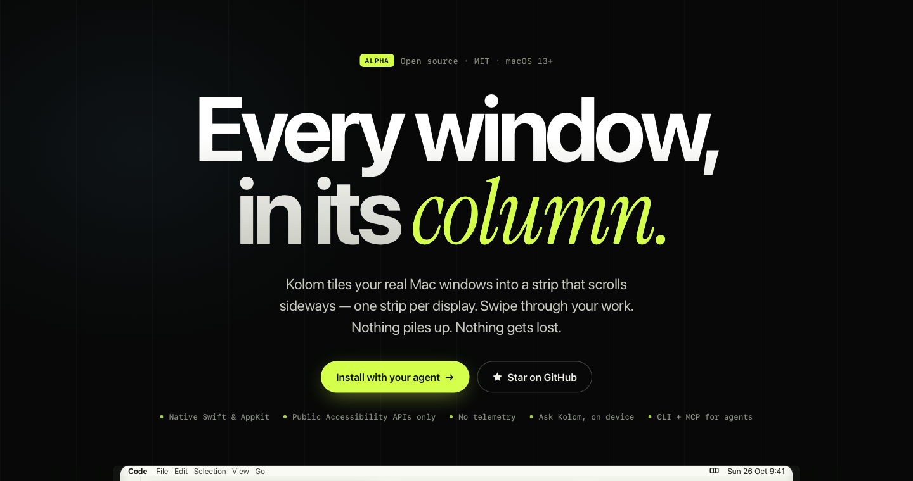
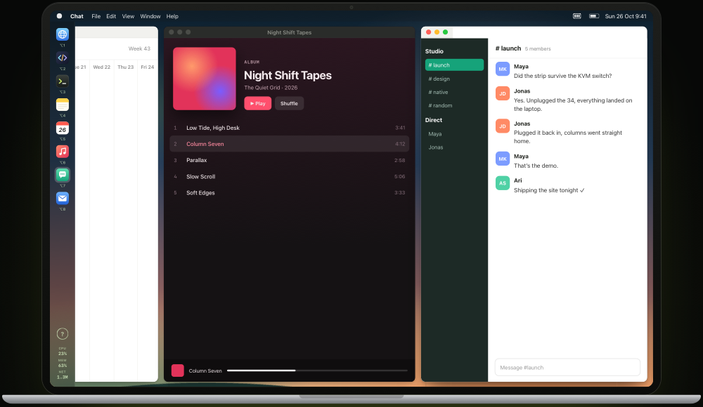
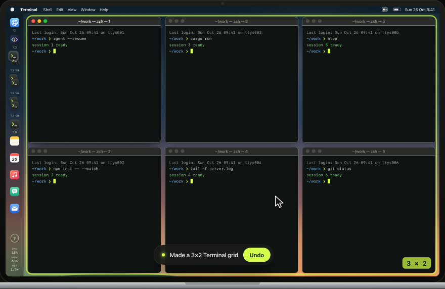

<p align="center">
  <a href="https://ckluis.github.io/kolom/"></a>
</p>

<p align="center">
  <b>A native macOS tiling window manager that puts every window in a column of one scrolling strip.</b><br>
  One strip per display. Swipe through your work. Ask for a layout in plain words.
</p>

<p align="center">
  <a href="https://ckluis.github.io/kolom/"><b>Try the live demo</b></a> ·
  <a href="#install">Install</a> ·
  <a href="#ask-kolom">Ask Kolom</a> ·
  <a href="#for-ai-agents">For agents</a> ·
  <a href="docs/GUIDE.md">Docs</a>
</p>

<p align="center">
  <a href="LICENSE"></a>
  
  
  
  <a href="https://github.com/ckluis/kolom/actions/workflows/ci.yml"></a>
</p>

---

Windows pile up. Kolom lines them up instead: each window gets a column in a strip that scrolls sideways, new windows join the strip, nothing overlaps, and two fingers take you anywhere. These are your real app windows, moved through the public Accessibility API. There is no fake desktop, and your title bars, Dock and menu bar stay as they are.

<p align="center">
  <br>
  <sub>From the <a href="https://ckluis.github.io/kolom/">interactive demo</a>.</sub>
</p>

## Install

Paste this into Claude Code, Codex or any coding agent on your Mac:

```
Read https://github.com/ckluis/kolom/blob/main/INSTALL-WITH-AN-AGENT.md and follow it.
```

Or do it yourself. You need macOS 13 or later and the Xcode command-line tools (`xcode-select --install`); the build takes about a minute.

```sh
git clone https://github.com/ckluis/kolom.git && cd kolom
./scripts/install.sh
```

Then turn on Kolom in **System Settings → Privacy & Security → Accessibility**. Kolom opens its built-in guide the first time it runs, and the **?** in any rail brings it back. To update, run `git pull && ./scripts/install.sh`.

There is no notarized download yet. The installer signs your build with a local certificate it creates, so the permission survives updates.

## What you get

| | |
| --- | --- |
| **Columns that scroll** | Every window gets a column in a sideways strip. Swipe with two fingers, use ⌥← ⌥→, or keep going for the desktop. |
| **Stacks** | Drag one rail icon onto another and the two windows share a column. Up to three windows can stack. Drag the edges to resize. |
| **A rail per display** | One icon per window, ⌥1–⌥9 to jump, plus live CPU, memory and network readings. Click the readings for a performance dashboard. |
| **Every monitor its own strip** | Each display keeps its own columns, focus and scroll position. Unplug a monitor and its windows move to your main display; plug it back in and they return. |
| **Clean edges between monitors** | Columns slide off every screen edge cleanly, even between side-by-side monitors ([how](#the-display-staircase)). |
| **Ask Kolom** | Press ⌥K and type "3×2 terminals on screen 2". It runs on Apple's on-device model ([more](#ask-kolom)). |
| **Agent-ready** | `kolomctl` and a local MCP server let Claude Code and other agents read and build your layout ([more](#for-ai-agents)). |
| **Safe to quit** | Pause or quit and every window goes back where it was. A watchdog restores windows and wallpaper even after a crash. |
| **Your look** | Light, Dark or your own wallpaper behind the strip. |

## Ask Kolom

<p align="center">
  
</p>

Press **⌥K** and say what you want:

| You type | Kolom does |
| --- | --- |
| `3×2 terminals on screen 2` | opens six Terminal windows in a 3×2 grid on your second screen |
| `8 terminals` | a 4×2 grid on the screen under your pointer |
| `focus Safari` | brings Safari's window into view |
| `move this window to screen 1` | moves the focused window to your first screen |
| `show the desktop` · `next column` | scrolls the strip |
| `dark theme` · `undo that grid` · `pause` | does exactly that |

Apple's on-device model (macOS 26 with Apple Intelligence) turns your sentence into one Kolom action, and Kolom checks it before anything runs:
- grid sizes you type are kept exactly;
- grids stop at 60 windows;
- anything it isn't sure about gets an explanation instead of a guess.

Nothing leaves your Mac, and there's no account or subscription. On older macOS, Kolom works as usual and the bar explains what Ask Kolom needs.

Screens are numbered left to right as they stand on your desk; the bar shows the numbers.

## Keys

| Keys | Action |
| --- | --- |
| two-finger swipe · ⌥/⇧ + wheel | scroll the strip |
| ⌥← / ⌥→ | previous / next column |
| ⌥1 … ⌥9 | focus a window |
| ⌥D | scroll to the desktop |
| ⌥K | Ask Kolom |
| ⌃⌥K | move the focused window: before, after, above, below, another display |
| ⌥M | Kolom commands |

The menu bar icon has **Pause and restore windows**, **Quit Kolom**, the **Kolom Guide** and the settings.

## The display staircase

Side-by-side monitors share an edge, so a column scrolling off one screen would show up on the next. Other tilers hide it early or let it leak. While Kolom manages your windows, it moves your displays corner to corner, so every edge is open space and columns slide off cleanly.

The pointer is still routed as on your real desk, so moving between monitors feels unchanged. Pause or quit and your arrangement comes back; if Kolom crashes, macOS restores it by itself. To turn this off, use **Keep displays apart while managing** in the menu bar icon's menu.

The idea and the pointer mapping come from [Defi](https://github.com/qeude/Defi) (MIT).

## For AI agents

Kolom ships `kolomctl` and a local MCP server. Connect Claude Code once:

```sh
claude mcp add --scope user kolom -- ~/.local/bin/kolomctl mcp
```

Other MCP clients use the same command as a stdio server. The installer offers to run it for you.

Agents can always read your layout and plan grids. To let them create or move windows, choose **Allow local agent commands…** in the menu bar icon's menu; that permission lasts until you turn it off or quit. Then try "make me a 6×3 Terminal grid on my left monitor" and "undo that grid".

There's no network listener and no shell execution. See [docs/AGENT-INTERFACE.md](docs/AGENT-INTERFACE.md).

## Privacy and safety

- **Accessibility** moves and resizes windows. **Automation** is asked for only when you create a Terminal grid.
- No screen capture, no telemetry, no network connections. Ask Kolom runs on your Mac.
- Public macOS APIs only: no SIP changes, no code injection, no private WindowServer APIs.
- Pause, quit, crash or lost permission: your windows stay reachable and go back where they were.

See [SECURITY.md](SECURITY.md) to report a vulnerability.

## Status

Kolom is alpha software. It runs daily on a three-monitor desk, and 25 groups of core checks cover layout, stacks, grids, displays, recovery, the staircase and Ask Kolom's checks. Sleep and wake, DisplayLink docks and broad app compatibility still need more live testing. [docs/SPEC.md](docs/SPEC.md) lists what is built and what is partial.

**Known limits:**
- The global ⌥ shortcuts take over the characters those keys would type (⌥K no longer types "˚"; on a German layout, ⌥5–⌥9 type `[ ] | { }`).
- Shortcuts are not configurable yet.
- A window can't span two displays.

Found a bug? [Open an issue](https://github.com/ckluis/kolom/issues/new?template=bug_report.yml) and include the output of `python3 -I scripts/live-check.py`.

## Development

```sh
./scripts/test.sh                  # core checks; no permissions needed
./scripts/build-app.sh             # builds build/Kolom.app
python3 -I scripts/live-check.py   # read-only health check of a running session
./kolomctl help                    # the CLI, against build/Kolom.app
```

- [docs/GUIDE.md](docs/GUIDE.md): the technical guide.
- [docs/SPEC.md](docs/SPEC.md): decisions and the status of every feature.
- [CONTRIBUTING.md](CONTRIBUTING.md): how to send a change.

The rule that matters most: a change that can strand a window doesn't ship.

## Inspired by

Kolom stands on ideas from these projects. Thank you.

- [niri](https://github.com/niri-wm/niri): the scrollable-tiling compositor that made the model click.
- [PaperWM](https://github.com/paperwm/PaperWM): scrollable tiling on GNOME.
- [Defi](https://github.com/qeude/Defi): a niri-inspired macOS tiler. Kolom adapts its display staircase and pointer mapping (MIT, see [THIRD-PARTY-NOTICES.md](THIRD-PARTY-NOTICES.md)).
- [Paneru](https://github.com/karinushka/paneru), [OmniWM](https://omniwm.app/), [Nehir](https://github.com/apphane-dev/nehir) and [Strip](https://enisbrik.github.io/strip/): other takes on scrolling windows on macOS.
- [AeroSpace](https://nikitabobko.github.io/AeroSpace/), [yabai](https://github.com/asmvik/yabai) and [Hyprland](https://hypr.land/): tiling done seriously.
- [Trellis](https://trelliswm.app/), [Shoji](https://shojimac.com/), [TileMyMac](https://tilemymac.app/), [ChainYourMac](https://chainyourmac.com/), [Spear](https://spearui.com/), [Panevisa](https://panevisa.com/) and [Beam](https://beam.win/): window-layout ideas worth studying.

## How it was built

Kolom was designed and directed by [Chris Kluis](https://github.com/ckluis) and written with AI coding agents: OpenAI Codex first, then Anthropic's Claude. It was called Ribbon before 0.2.0.

If Kolom makes your desk calmer, a ⭐ helps other people find it.

## License

[MIT](LICENSE). Third-party code is listed in [THIRD-PARTY-NOTICES.md](THIRD-PARTY-NOTICES.md).
